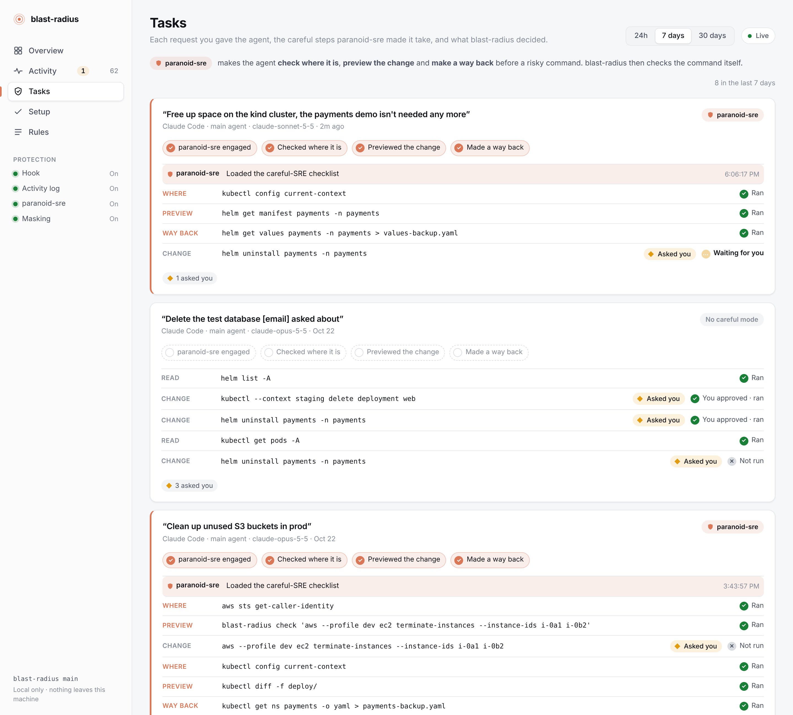
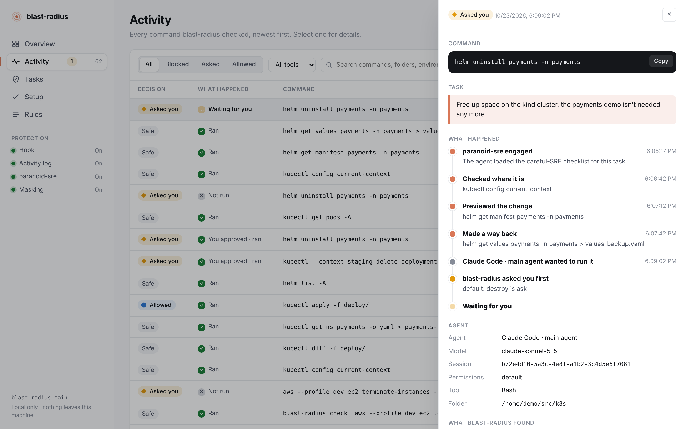
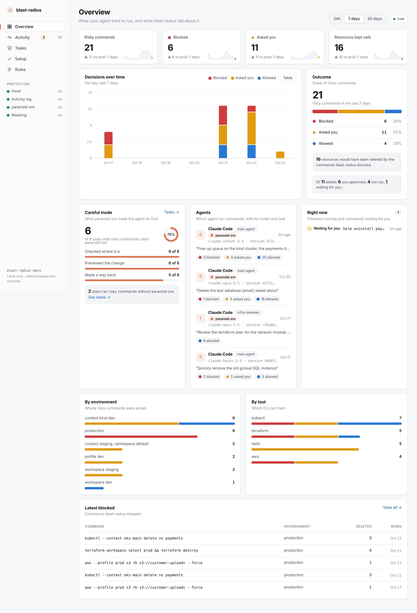
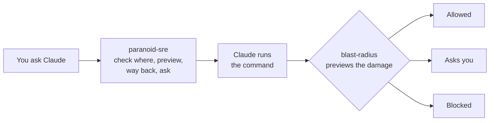

# paranoid-sre

[](https://github.com/SandeepKomal/paranoid-sre/actions/workflows/ci.yml)
[](https://github.com/SandeepKomal/paranoid-sre/actions/workflows/codeql.yml)
[](https://scorecard.dev/viewer/?uri=github.com/SandeepKomal/paranoid-sre)
[](https://github.com/SandeepKomal/paranoid-sre/releases)
[](LICENSE)

**A Claude skill that makes your AI agent handle infrastructure like a careful SRE:** check
which environment it is in, preview the change, find a way back, and ask before anything it
can't undo.

Ask an agent to "clean up the old servers" and it will often just run the delete. With this
skill it works through the steps an experienced engineer would, and comes back with something
like:

```
Target:    AWS account 1234-5678-9012 (prod), us-east-1
Change:    terminate 3 instances: web-old-1, web-old-2, batch-legacy
Data loss: batch-legacy has an attached volume that is deleted with it
Way back:  none for the volume; I can snapshot it first
Command:   aws ec2 terminate-instances --instance-ids i-0a1 i-0b2 i-0c3
```

and waits for your answer.

## Contents

- [See it working](#see-it-working)
- [What it makes Claude do](#what-it-makes-claude-do)
- [Works with blast-radius](#works-with-blast-radius)
- [Install, step by step](#install-step-by-step)
- [When it is used](#when-it-is-used)
- [Privacy and India's DPDP Act](#privacy-and-indias-dpdp-act)
- [Trust and security](#trust-and-security)
- [Limitations](#limitations) · [Contributing](#contributing) · [Code of conduct](#code-of-conduct) · [License](#license)

## See it working

A skill works inside Claude's reasoning, so on its own there is nothing to look at. With
[blast-radius](https://github.com/SandeepKomal/blast-radius) installed, its dashboard
(`blast-radius ui`) shows exactly what paranoid-sre made the agent do. Screenshots use sample
data; click for full resolution.

**Tasks**: each request as a story. paranoid-sre is loaded, the agent checks where it is,
previews the change and makes a way back, *then* runs the risky command, which blast-radius
checks once more.

[](docs/screenshots/tasks.png)

**Details**: the timeline for one command, from your request through paranoid-sre's steps to
blast-radius's decision and the result.

[](docs/screenshots/details.png)

**Overview**: the *Careful mode* card shows how many tasks with risky commands used
paranoid-sre and which steps were taken, next to everything blast-radius blocked or asked
about.

[](docs/screenshots/overview.png)

## What it makes Claude do

1. **Find out where it is.** Workspace, kube context, cloud account, project or subscription,
   database host, checked with read-only commands. Anything it can't identify is treated as
   production.
2. **Preview the change** with the tool's own dry run: `terraform plan`, `kubectl diff`,
   `--dry-run=server`, `helm get manifest`, `pulumi preview`, `SELECT count(*)`.
3. **Rate it**: read-only, reversible, or irreversible. Replacements count as deletions; a
   namespace or resource group counts as everything in it.
4. **Make sure there is a way back**: backups, snapshots, deletion protection, versioning, a
   rollback command written down in advance.
5. **Keep it small**: named resources instead of wildcards, one environment and one changing
   command at a time.
6. **Ask before anything irreversible**, showing target, change, data loss, way back and the
   exact command. "Quickly" and "it's only staging" don't skip this.
7. **Watch the result** and stop if anything is unexpected, instead of retrying with `--force`.

It also handles **personal data and secrets** with care: count rows instead of printing
customer tables, never copy production personal data elsewhere, never print secrets, and treat
deleting personal data as irreversible.

And it lists what Claude must never do unless you ask for that exact action, such as turning
off deletion protection, skipping final snapshots, force-unlocking state, removing finalizers,
widening its own IAM permissions, or working around a guard that blocked it.

Covers Terraform, OpenTofu, Terragrunt, Pulumi, Kubernetes, Helm, AWS, Google Cloud, Azure and
SQL databases, with a reference page for each in [skills/paranoid/references](skills/paranoid/references).

## Works with blast-radius

A skill is instructions. It makes Claude careful, but it can't stop a command.
[blast-radius](https://github.com/SandeepKomal/blast-radius) is a hook that does.



| | paranoid-sre | blast-radius |
| --- | --- | --- |
| What it is | Skill (instructions) | Hook (program) |
| When it acts | While Claude plans | Just before a command runs |
| Can Claude ignore it | It follows it like any instruction | No |
| What you see | Its steps, in the blast-radius dashboard | Every decision, in its dashboard |

paranoid-sre uses `blast-radius check '<command>'` for previews when blast-radius is
installed, and blast-radius records when paranoid-sre is loaded and which of its steps the
agent took. Use both: paranoid-sre makes mistakes rare, blast-radius stops the ones that slip
through.

## Install, step by step

### Option 1: Claude Code plugin (recommended)

In Claude Code:

```
/plugin marketplace add SandeepKomal/paranoid-sre
/plugin install paranoid-sre@paranoid-sre
```

Or from a terminal:

```bash
claude plugin marketplace add SandeepKomal/paranoid-sre
claude plugin install paranoid-sre@paranoid-sre
```

Restart Claude Code. Update later with `claude plugin update paranoid-sre@paranoid-sre`.

### Option 2: copy the skill

For yourself:

```bash
git clone https://github.com/SandeepKomal/paranoid-sre
mkdir -p ~/.claude/skills
cp -r paranoid-sre/skills/paranoid ~/.claude/skills/
```

For everyone working in a repository, copy `skills/paranoid` to `.claude/skills/paranoid` in
that repository and commit it.

### Option 3: Claude.ai and the API

Each [release](https://github.com/SandeepKomal/paranoid-sre/releases) has a `paranoid.zip` you
can upload as a skill in Claude.ai, or send to the
[Skills API](https://platform.claude.com/docs/en/api/skills-guide). Verify it first:

```bash
gh attestation verify paranoid.zip --repo SandeepKomal/paranoid-sre
sha256sum -c checksums.txt
```

### Add blast-radius and its dashboard

```bash
go install github.com/sandeepkomal/blast-radius@latest   # or download a release
blast-radius install
blast-radius init --user      # turns on the activity log the dashboard reads
blast-radius ui               # http://127.0.0.1:7357
```

The dashboard's Setup page ticks off each step, including paranoid-sre. See the
[blast-radius README](https://github.com/SandeepKomal/blast-radius#install-step-by-step) for
details.

## When it is used

Claude loads the skill on its own when a task involves changing infrastructure or data:
`terraform apply`, `kubectl delete`, `helm uninstall`, cloud CLI changes, migrations, `DROP`
and `DELETE` statements, IAM, DNS and firewall changes, or requests to clean up, tear down,
reset or fix an environment. You can also call it directly with `/paranoid-sre:paranoid` (or
`/paranoid` when copied as a skill).

## Privacy and India's DPDP Act

paranoid-sre is a set of instructions. It contains no code that runs, collects nothing, and
sends nothing anywhere. What it does is make Claude handle personal data the way India's
Digital Personal Data Protection Act expects: minimum data, no copies, no secrets in logs, and
deletions treated as irreversible. [docs/privacy.md](docs/privacy.md) has the details and a
checklist; for the activity log blast-radius keeps, see
[its privacy page](https://github.com/SandeepKomal/blast-radius/blob/main/docs/privacy.md).

## Trust and security

**The skill**

- [x] Plain Markdown, readable in full before you install it: no scripts, no network calls, no
      tools beyond what Claude Code already has.
- [x] Checked on every pull request against the rules Claude.ai and the Skills API enforce
      (`scripts/check.py`) and by `claude plugin validate --strict` (pinned version).
- [x] Every command it recommends is read-only or asks first; it forbids working around guards
      such as blast-radius.

**The repository and releases**

- [x] **CodeQL** scans the workflows and scripts on every pull request and weekly.
- [x] **gitleaks** scans the full git history for committed secrets in CI.
- [x] **Dependabot** keeps the GitHub Actions up to date.
- [x] **OpenSSF Scorecard** rates the supply-chain practices weekly (badge above).
- [x] Every GitHub Action is pinned to a full commit SHA; workflows run with read-only tokens
      by default and don't keep credentials in the checkout.
- [x] Releases publish `paranoid.zip` with `checksums.txt` and **signed build provenance**.

Report security problems privately as described in [SECURITY.md](SECURITY.md).

## Limitations

- It guides the agent; it does not enforce anything. Use blast-radius, Claude Code's permission
  rules and least-privilege credentials for hard limits.
- Asking before irreversible changes means more questions. That is the point, but it is slower
  for routine work in sandboxes.

## Contributing

Corrections and new reference pages are welcome. See [CONTRIBUTING.md](CONTRIBUTING.md), and
[.claude/CLAUDE.md](.claude/CLAUDE.md) for the rules agents follow when changing this repository.

## Code of conduct

Everyone taking part follows the [code of conduct](CODE_OF_CONDUCT.md) (Contributor Covenant
2.1).

## License

[MIT](LICENSE): free to use, change and share, including commercially, as long as the
copyright notice stays with it.
